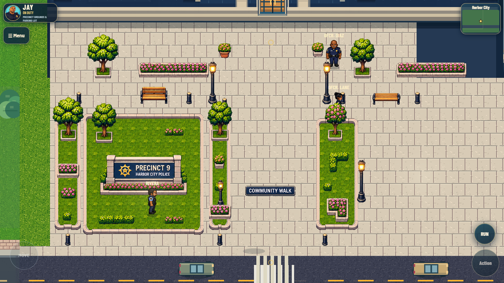
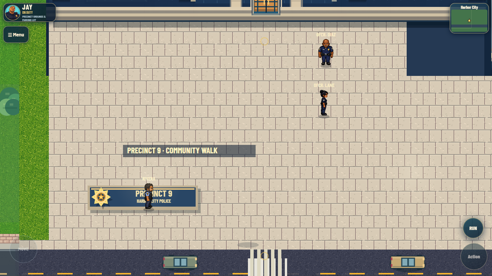
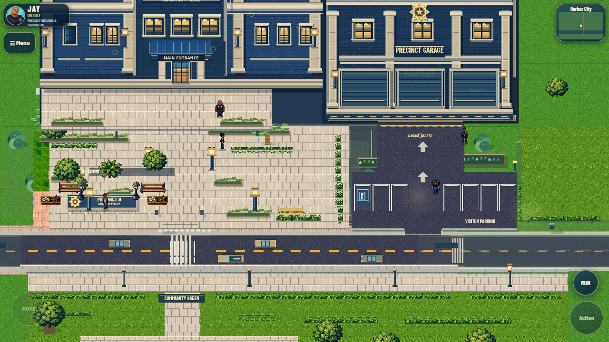
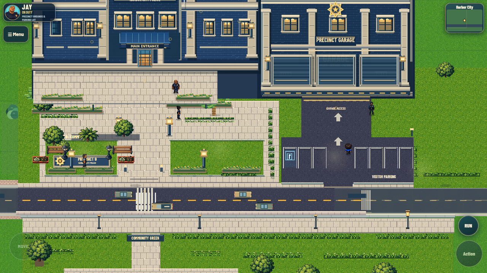

# Precinct 9 — Option A implementation review

## Current revision: owner asset arrangement

The owner supplied a Community Walk asset sheet, then explicitly selected a new
arrangement using trees, planters, benches and lights from that pack. This
supersedes the cleared-plaza revisions below.

Twenty-five sprite frames are extracted by `tools/prepare_community_walk_assets.py`:
grass, three tree varieties, both benches, tall/short lamps, long/corner hedges,
shrubs, flowering shrubs, loose flowers, long/small/corner planters, both flower
pots, bollards, precinct monument, Community Walk sign, straight/vertical curbs
and two curved corner modules.
Source crops and cleanup settings are recorded in
`assets/community-walk/manifest.json`; the supplied original remains in
`docs/references/community-walk-asset-sheet.png`. The extraction uses one-half
source scale with nearest-neighbor sampling, removes matte noise and detached
pixels, and packs the source artwork into one transparent 512×512 atlas.

The placement follows the reference's relationships: the two benches sit on
the same horizontal paved frontage, with lamps/posts beside them, and matching
trees/flower boxes above. There is no bench in the sidewalk below the lawn.
The main lawn is now 288×288 at world `(480,1368)`, leaving 53 world pixels of
continuous paving between its outer curb and Harbor Avenue. Narrow curbed
gardens occupy `(408,1380,48,264)`, `(800,1380,36,264)` and
`(1072,1380,88,264)`: these provide the west planted boundary and the tree,
shrub and flower areas on both sides of the central walk. All supplied
landscaping categories are used in their appropriate zones rather than spread
through the circulation space. The floor-inset Community Walk panel is centered
at `(948,1575)` and renders under actors; other objects stay outside the
x860..1035 walking corridor and west of the parking/garage route.

The grass texture, stone curb modules and rounded corners come from the supplied
sheet. The monument remains inside the lawn with its flowers at the base.
It is offset from Rivera's existing position so he draws in front of it. Original
furnished rooms, entrances, road and collision remain intact; these decorations
do not add new colliders.

The existing V135 loader reads the new atlas only after the connected campus
opens. V134 owns the placement data, and objects join the existing actor
feet-depth queue in V115. There is no separate renderer, scene or game loop.
Historical bench, plant, lamp and label painters stay disabled for this layout.



[Mobile capture](review/community-walk-mobile.png) ·
[Runtime results](review/community-walk-runtime.json).

## Owner revision: clear the plaza

The owner subsequently requested removal of all trees, shrubs, partial palms
and park benches from the pedestrian plaza, with matching continuous paving.
That revision supersedes the planted civic islands described in the first pass
below. V133 now fills one stone surface from `(387,1127)` to `(1629,1721)`;
the existing atlas repeats on its global pixel grid. V134's late forecourt
uses that same grid without internal border bands. The old pilot furniture
and glow passes are disabled in this layout, V115's two plaza trees are omitted,
and V134 no longer contributes flower boxes or palms to the cleared area.
The monument, building entrances and collision remain intact. A further owner
revision removes all four large freestanding plaza lamps, four small lighted
bollards and two narrow legacy light posts from this same paved area. Building
lighting, the parking-perimeter lamp and other districts retain their lighting.



[Actual mobile capture](review/plaza-cleared-mobile.png) and
[revision runtime results](review/plaza-cleared-runtime.json).
Both requested viewports passed lobby entry/exit and sampled parking collision
checks with no uncaught JavaScript exceptions. The same five inherited missing
asset requests remain. Existing source checks for V133/V134 and syntax checks
passed. Earlier images and walkthrough below record the first layout pass.

The owner supplied the approved image on November 2, 2026. It is retained at
`references/precinct9-approved-option-a.png` as a design reference, never loaded
as a gameplay overlay. This focused change applies its layout principles to
the existing 1:1 campus without moving either entrance or Harbor Avenue.

## Changes

- V133 now authors the north-campus base surface. Existing optional historical
  terrain painters are clipped outside its rectangle in the V140 preview, and
  V130's obsolete parking paint is skipped there. Other districts retain their
  original painting paths.
- Two planted civic islands flank the central walk. The precinct monument stays
  on the left; flower borders sit at island edges rather than across the route.
- A continuous stone sidewalk connects the plaza to the original avenue; the
  existing garage drive cuts through it with a clear curb opening.
- The original campaign's obsolete plaza visitor-parking sign is omitted only
  in this preview. Its MAPS data and the campaign remain untouched.
- Seven existing stalls, the central garage approach, building footprint,
  collision, roof fading, doors, characters and flags retain their coordinates.
  No vegetation was added inside parking or the approach. The concept's extra
  parking row is not compressed into the smaller available world footprint.
- The ground cache key includes the approved-layout state so cached historical
  terrain cannot be reused after that state changes.
- A Windows CRLF comparison bug in the original scope builder is corrected with
  byte-for-byte engine verification. `prepare_local_review.py` provides one
  reproducible command for the existing builder chain and pinned comparison.

## Actual game evidence

| Before | After |
| --- | --- |
|  |  |

[Mobile parking](review/parking-after-mobile.png),
[furnished lobby](review/interior-after-desktop.png),
[continuous keyboard walkthrough](review/precinct9-walkthrough.webm).
These are browser captures of the native Canvas game. The walkthrough includes
initial camera/position setup, then continuous keyboard travel through the lobby,
plaza-side path, parking aisle and garage entrance. Its setup and screenshot
camera jumps are not represented as continuous player travel.

## Validation

Passed source checks for V133, V134, road connectivity and traffic, JavaScript
syntax checks and `git diff --check`. Built and ran the existing preview in
Chrome at 390×844 (mobile/touch emulation) and 1280×720.

Both before/after variants passed W/S lobby crossing, roof-alpha recovery,
continuous plaza-to-garage keyboard navigation, and sampled parking collision
parity. Emulated touch joystick input moved Jay approximately 74 pixels before
and 77 pixels after. All four precinct runs reported zero uncaught JavaScript
exceptions. See [runtime results](review/runtime.json).

The original `game.js`, outbreak CSS, world topology, marina, Jay and citywide
modules are byte-identical between generated before/after builds; all game
source/assets outside the three precinct rendering modules are unchanged in
Git. See [source protection](review/source-protection.json).

Zombie was started through the existing Academy API after selecting Jay, and its
native armory UI equipped the rifle. Before/after seeded map data, initial
status and armory state matched, and the connected-campus API refused to open
while Zombie was active. [Protected-mode results](review/protected-mode.json)
and [actual armory capture](review/zombie-startup-after.png) record this bounded
check. **This is not certification of a full Zombie objective playthrough.**
The older scripted helper skips required armory preparation; a manual/complete
objective regression remains outstanding. No protected-mode behavior was edited.

## Remaining issues and review boundary

- Five existing missing-asset requests remain in both variants: parking bay,
  wheel stop, and three civilian images. They were not replaced through shared
  systems during this precinct-only change.
- Physical Android performance, full campaign missions/driving, all-district
  exploration and complete dynamic scenery depth are not certified by this QA.
  The connected world remains a preview alongside the preserved campaign.
- The image's architectural richness, full landscaped tree composition and
  two-row parking do not fit this footprint exactly. This review improves the
  actual layout using current art; it is not a claim of final visual completion.
- No production deployment, historical branch rewrite or merge is authorized
  by this review. The PR targets the V140 source branch, not deployment-only main.

## Reproduction

```powershell
python tools/prepare_local_review.py
python -m http.server 8767 --bind 127.0.0.1 --directory site
```

Open `http://127.0.0.1:8767/` for the playable before/after selector. Source remains
in `published-game-capture`; do not edit generated `site/` files as development
inputs. Python UTF-8 mode is inherited by the whole builder chain. The baseline
comparison reconstructs the three changed render modules and injected campus
from pinned commit `e762267` inside an otherwise identical generated build.

With Playwright, its FFmpeg dependency and Chrome available:

```powershell
node qa/audit-baseline.cjs --review
```

The audit server listens only on 127.0.0.1:8766 during that run and then closes.
The interactive review server above is separate; stop it with Ctrl+C.
