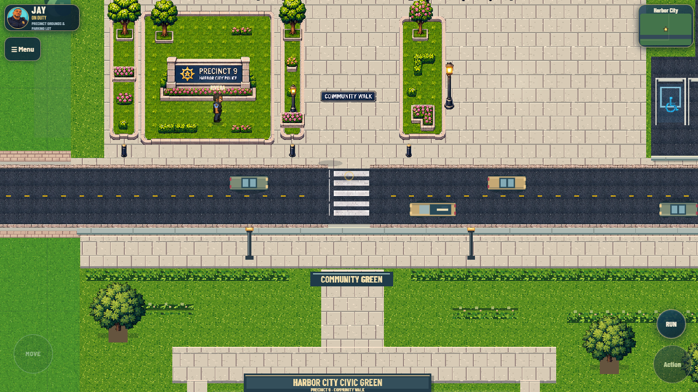

# Owner roadway asset pass

[Mobile frontage](review/roads/precinct-front-mobile.png) ·
[Midtown junction](review/roads/midtown-four-way.png) ·
[Northgate junction](review/roads/northgate-junction.png) ·
[Road plan](review/roads/road-plan.json) ·
[Before/after runtime checks](review/roads/regression.json).

The supplied Roadway Option B sheet is preserved as
`references/roadway-asset-sheet.png`. `tools/prepare_roadway_assets.py` extracts
native asphalt, curbs, yellow paint, crosswalk paint, an approach arrow and the
accessible-parking symbol into `assets/roadway/roadway-atlas.png` and its manifest.
Opaque asphalt was removed from the paint stencils so they cannot introduce
rectangular pavement patches or mismatched backgrounds.

## Start at the precinct and follow the existing streets

Harbor Avenue remains at its original y1721..1848 footprint. Community Walk's
crossing is centered on world x948. The garage approach still joins through
x1856..2002, with no curb across its mouth. Existing visitor parking, drive and
garage apron share the roadway material and use the supplied wheelchair/arrow
art while preserving their original painted stall coordinates.

The finish follows all 18 immutable inter-district road segments outward,
including the Maple collector, western ring, Midtown/Bayview feeder, Northgate
and Downtown links and Southbay loop. The runtime audit found that the graph
omits some streets already authored inside district ground data. Their existing
rectangles (21 in this captured build) are included in the visual union, preventing curb bars across the
north leg of Midtown and other native junctions.

Native road-color rectangles are read from district ground without modification.
The older generic asphalt color is included only for long, narrow street shapes;
large parking pads are not assumed to be public streets. Protected waterfront
ground is excluded. The canonical graph, authored rectangles, collision and
traffic paths are never rewritten by this visual pass.

## Alignment and drawing ownership

- The existing V135 atlas loader loads road assets only while the connected
  campus is open. Zombie/Academy startup does not load the road atlas.
- Collinear source rectangles are merged on visual copies. Asphalt repeats
  from global world coordinates at native pixel size, so district and tile
  boundaries do not reset the material or create seams.
- Curbs are clipped out where another existing road meets an edge. The garage
  approach and precinct pedestrian crossing have explicit curb openings.
- Overlapping native and connector definitions share a single centerline based
  on their visible union. Dashes share one phase and stop across junction mouths.
- Crosswalk stencils use whole-number scale fitted inside the actual road
  width. Junction crossings sit on approaches, and nearby duplicate district
  seam crossings are suppressed.
- One road finish runs in the existing Canvas ground stage before actors.
  Earlier precinct road paint and obsolete legacy plaza crossing/gate art are
  disabled once the new material is ready. No new engine, scene or frame loop.

Precomposed showcase intersection pictures are not stretched over differently
sized world junctions. Their supplied material/marking style is composed at
the actual road widths and branch openings instead.

## Evidence and limits

Actual Chrome captures at 390×844 and 1280×720 cover precinct frontage, the east
seam, Maple, Midtown, Northgate, the lower Midtown junction, western ring and
Southbay junction. Runtime checks sample the original segment centerlines,
check the native north leg at Midtown, and verify that every new crossing's
bounds fit within the road union, including width transitions. The visual plan
contains 25 merged rectangles and 14 deduplicated crossing locations. Source road-connectivity and traffic checks
also remain required.

The existing before/after QA additionally tests lobby entry/exit, garage travel,
touch movement and bounded Zombie startup/map/equipment parity. These checks
do not certify physical Android frame rates, a complete Zombie playthrough,
or migrated player driving: the connected city remains a visual/walking preview
alongside the original campaign. Five inherited missing-asset requests remain.

Large private parking areas away from Precinct 9 and the protected Marina keep
their previous art; they need location-specific parking plans before a later
conversion. This pass aligns the existing connected public streets rather than
inventing new roads or changing district layouts.

Rebuild with `python tools/prepare_local_review.py`; view the existing local
comparison at `http://127.0.0.1:8767/`. Regenerate roadway assets from the preserved
sheet with `python tools/prepare_roadway_assets.py` when changing extraction.
